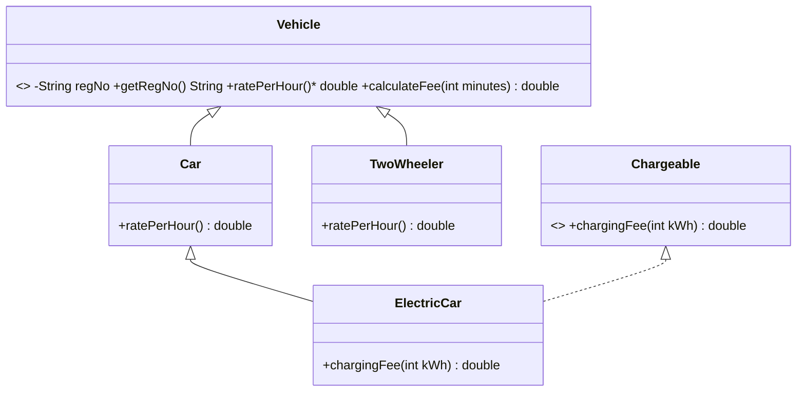

# Task 6 - UML class diagram (Mermaid; renders on GitHub)

Inheritance type: hierarchical (Vehicle -> TwoWheeler, Car) + multilevel (Vehicle -> Car -> ElectricCar).
Constructor order: Vehicle() -> Car() -> ElectricCar().
